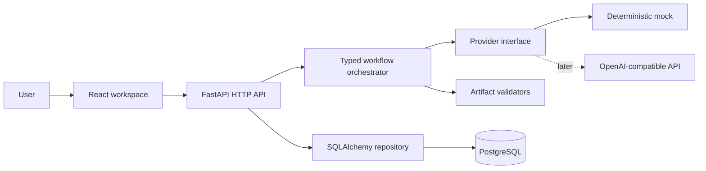

# System architecture (proposed MVP)

## Scope and boundaries

Phase 1 establishes the executable foundation. Phase 2 will provide a local single-operator workflow: create a project, analyze requirements with a deterministic mock provider, review assumptions and clarifications, generate a structured architecture, save a revision, and inspect a graph. Authentication and multi-tenancy are outside the MVP; deployment to an untrusted network is unsupported.

The browser never receives provider keys. The Phase 2 API will accept bounded descriptions and persist user edits separately from provider suggestions. The orchestrator will pass explicit typed state between steps (requirements, architecture, review), record step status and usage, and commit a validated revision only after all consistency checks pass. LangGraph should be introduced in Phase 3 if branching, resumability, or human review warrants the dependency; an explicit Python state machine is sufficient for the MVP.

## Data flow

1. User submits an idea and creates a project.
2. Requirements analysis returns source-tagged requirements, assumptions, and clarification questions. User can edit them before generation.
3. The orchestrator calls the selected provider through one interface. Provider responses are parsed into Pydantic models, validated for cross-artifact consistency, and stored as a revision.
4. The API derives diagram nodes and edges from validated components and relationships. The frontend renders data only, never executable provider output.
5. A later component edit creates a new revision. Reopening a project uses persisted revisions, not another provider call.

## Module boundaries

- `architect/api`: HTTP routes, request and response contracts, safe error mapping.
- `architect/core`: environment settings and logging policy.
- `architect/db`: SQLAlchemy metadata, sessions, and persistence models.
- Future `architect/domain`: artifact schemas and cross-artifact validators.
- Future `architect/providers`: mock and live implementations of one provider protocol.
- Future `architect/workflow`: orchestration, step status, and run history.

Routes should not construct prompts, and providers should not write to the database. A repository layer will own queries once project CRUD is added.

## Data model evolution

The initial migration creates `projects` only, proving the database and migration path without inventing unused columns. Phase 2 will add requirement versions, architecture revisions, and run records with provider identity and explicit status. Future schema and OpenAPI designs are artifacts, not deployed database tables or service endpoints.

## Technology decisions

| Decision | Reason | Tradeoff |
| --- | --- | --- |
| FastAPI and Pydantic v2 | Typed HTTP contracts and validation | Python runtime capacity needs monitoring |
| PostgreSQL and SQLAlchemy 2 | Durable relational project history with controlled migrations | Local setup requires a database |
| React and TypeScript | Interactive workspace with typed API use | Frontend build toolchain adds maintenance |
| TanStack Query | Cache and error state for server data | Keep client-only state outside query cache |
| React Flow in Phase 2 | Graph navigation and component selection | Graph validation remains a backend responsibility |
| Mock provider first | Reproducible local development and tests | Mock results do not measure LLM quality |
| Explicit orchestrator first | Observable steps without needless framework coupling | LangGraph adoption requires a later migration if branching grows |

## Threats and operational limits

Prompt injection can influence a provider's design recommendation. Treat all generated content as untrusted; validation checks structure and consistency but cannot prove design quality. Never execute generated artifacts. Limit input and output size, provider time, retries, and cost. The foundation already provides request IDs, sanitized JSON request logs, bounded database waits, and safe health/error responses. Phase 3 will add workflow run status, provider token counts, cost, and LLM latency. Authentication, rate limiting, and tenant isolation must precede public SaaS deployment.

The [Phase 1.5 verification report](verification-phase-1-5.md) distinguishes the PostgreSQL behavior executed locally from the Docker configuration that still requires runtime verification.
